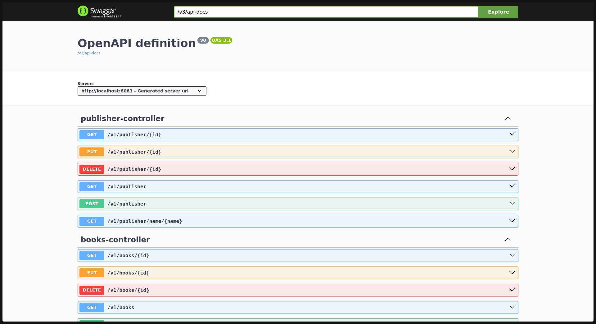
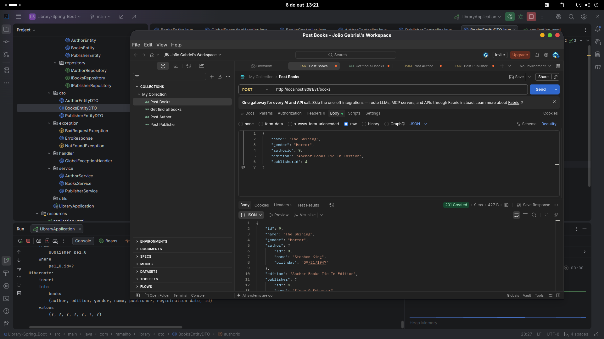

# Library API

A REST API for managing a library's catalog and operations. It provides resources for managing books, authors, and publishers, as well as recording loans and tracking fines, with JWT-based authentication.

## Features

- Manage books, authors, and publishers
- Record and retrieve loans, returns, and fines
- Authentication and authorization with Spring Security and JWT
- Request validation and standardized error responses
- Pagination and sorting for supported queries
- Interactive API documentation with OpenAPI and Swagger UI

## Technology Stack

Java 25 · Spring Boot · Spring Data JPA · PostgreSQL 17 · Spring Security · JWT · Docker Compose

## Run with Docker

Requirements: Git and Docker with Docker Compose.

Clone the repository and create a local configuration file:

```bash
git clone https://github.com/rmlho/Library-Spring_Boot.git
cd Library-Spring_Boot
cp .env.example .env
```

Edit `.env` and set your database credentials and a strong JWT key. To generate a random key, run `openssl rand -hex 32` and copy the output to `JWT_KEY`. For example:

```env
DB_USERNAME=library
DB_PASSWORD=set-a-strong-password
JWT_KEY=replace-with-a-strong-random-secret
JWT_EXPIRATION=86400000
```

`JWT_EXPIRATION` is specified in milliseconds; the example value corresponds to 24 hours. Do not share or commit the `.env` file.

Start the API and PostgreSQL:

```bash
docker compose up --build -d
```

Compose builds the API image locally and starts the services once the database is ready. Java, Maven, and PostgreSQL do not need to be installed on the host. The API is available at `http://localhost:8081`, and the interactive documentation at `http://localhost:8081/swagger-ui/index.html`.

To follow application logs and stop the services:

```bash
docker compose logs -f app
docker compose down
```

PostgreSQL data is retained in the `postgres_data` volume when the containers are stopped. To remove the data as well, run `docker compose down -v`.

## API

The main resources are available at:

| Resource | Base endpoint |
| --- | --- |
| Authentication | `/v1/auth` |
| Books | `/v1/books` |
| Authors | `/v1/author` |
| Publishers | `/v1/publisher` |
| Loans | `/v1/rent` |
| Fines | `/v1/fine` |

Register an account and log in to obtain a token:

```bash
curl -X POST http://localhost:8081/v1/auth/register \
  -H "Content-Type: application/json" \
  -d '{"email":"reader@example.com","password":"password123"}'

curl -X POST http://localhost:8081/v1/auth/login \
  -H "Content-Type: application/json" \
  -d '{"email":"reader@example.com","password":"password123"}'
```

Send the returned token in the `Authorization: Bearer <token>` header to access protected routes. The Swagger documentation lists the endpoints, parameters, and request formats.

<p align="center">
  
</p>

Example request and response in Postman:

<p align="center">
  
</p>

## Architecture

The application follows a layered architecture, separating HTTP controllers, business services, persistence repositories, and JPA entities. DTOs define input and output data, while a global handler standardizes error responses.

## Author

Joao Gabriel Ramalho · [@rmlho](https://github.com/rmlho)
